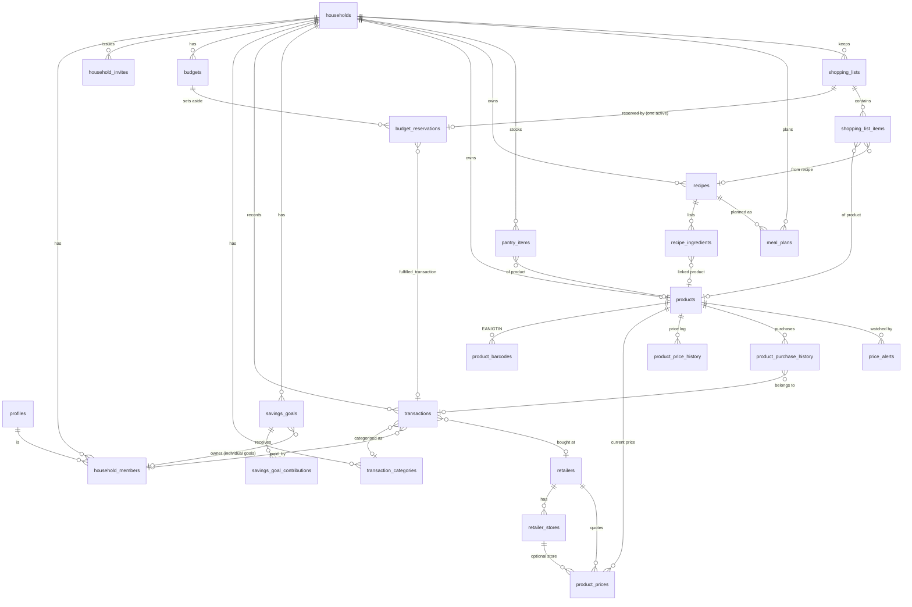

# Architecture

Household Budget is a mobile-first PWA for household budgeting in which a grocery ecosystem (products, Romanian
supermarket prices, recipes, meal planner, shopping lists) shares one budget and savings engine.

This document describes the **foundation**: schema, security model, budget engine and app shell. Grocery feature
workers build on top of it.

- [Stack](#stack)
- [Repository layout](#repository-layout)
- [Entity relationship diagram](#entity-relationship-diagram)
- [Row level security model](#row-level-security-model)
- [Budget engine](#budget-engine)
- [Product statistics and price history](#product-statistics-and-price-history)
- [App architecture](#app-architecture)
- [Conventions](#conventions)
- [Testing](#testing)
- [Extending the foundation](#extending-the-foundation)

## Stack

| Layer | Choice |
| --- | --- |
| Web | Next.js 16 (App Router, Server Components, Server Actions, `proxy.ts`), React 19, TypeScript (strict), Tailwind CSS 4 |
| Data | Supabase: Postgres 15+, Auth, Row Level Security, Storage |
| Validation | zod 4 at every server-action boundary |
| Tests | Vitest (unit), pgTAP (database + RLS) |
| i18n | Own typed catalogue (`ro` default, `en`), cookie based, no URL prefix |
| PWA | `app/manifest.ts`, generated icons, `public/sw.js` (static assets + offline page only) |

Money is stored as `numeric(14,2)` in the **household currency** (default `RON`) and handled in application code as
integer minor units (bani) to avoid floating point drift.

## Repository layout

```
supabase/
  migrations/             ordered SQL migrations (the source of truth for the schema)
  tests/database/         pgTAP tests (00000-test-helpers.sql installs helpers + fixture)
  tests/support/          Supabase shim so the suite runs on plain PostgreSQL
src/
  proxy.ts                session refresh + redirect of anonymous users to /login
  app/(auth)/             login, signup, auth actions
  app/(app)/              authenticated shell and the nine sections
  app/actions/            server actions (household, transactions)
  app/onboarding, invite/ create or join a household
  components/             UI kit and client components
  lib/budget-engine/      pure budget logic (no I/O) + tests
  lib/data/               server-side queries and the active-household context
  lib/i18n/               catalogues (ro, en), translator, provider
  lib/supabase/           browser / server / proxy clients
scripts/
  db-test.sh              apply migrations to a scratch DB and run pgTAP
  local-stack/            Docker-free backend harness (PostgREST + mock auth) for sandboxes
```

## Entity relationship diagram



### Tables

| Area | Tables |
| --- | --- |
| Identity & tenancy | `profiles`, `households`, `household_members`, `household_invites` |
| Budget & savings | `transaction_categories`, `budgets`, `transactions`, `budget_reservations`, `savings_goals`, `savings_goal_contributions` |
| Catalogue & prices | `retailers` (seeded), `retailer_stores`, `products`, `product_barcodes`, `product_prices`, `product_price_history`, `product_purchase_history`, `price_alerts` |
| Kitchen | `recipes`, `recipe_ingredients`, `pantry_items`, `meal_plans`, `shopping_lists`, `shopping_list_items` |

Notable design points:

- **Actual vs planned money.** `transactions` hold money that really moved. `budget_reservations` hold money set aside
  for planned shopping (usually tied to a `shopping_lists` row). They are never summed into expenses; the engine
  reports them as `reserved_*` and subtracts active ones from what is still available.
  `fulfill_budget_reservation()` turns a reservation into a real transaction and marks it fulfilled.
- **Per-member attribution.** `transactions.paid_by`, `savings_goal_contributions.user_id`,
  `product_purchase_history.purchased_by` reference `household_members (household_id, user_id)` and are nulled
  (`ON DELETE SET NULL (col)`) when a member leaves, so history survives.
- **Shared vs individual.** `transactions.scope`, `savings_goals.scope` and `shopping_lists.scope` take
  `shared | individual`. Individual rows must name a member (`paid_by` / `owner_id`). Individual spending is
  attributed, not private: every member of the household can read it.
- **Shared savings goals** are `scope = 'shared'` with contributions from any member; progress is derived from
  contributions (`savings_goal_progress` view).
- **Price provenance.** `product_prices.source` is `price_source` (`adapter | manual`); `match_method`
  (`barcode | name | manual | adapter_ref`), `match_confidence` (0..1, **required for adapter prices**) and
  `is_verified` describe how a price was linked to a product.
- **Barcodes** are validated with `is_valid_gtin()` (EAN-8/UPC-12/EAN-13/GTIN-14 with check digit) and unique per
  household.
- **Budgets** have `spending_limit` / `grocery_limit` (nullable: "no limit set" is a real state) and an exclusion
  constraint forbidding overlapping *active* budgets per household.
- **Categories** are per household; built-in ones are seeded on household creation with a `system_key` for
  localisation (`groceries` is the one flagged `is_grocery`, which drives grocery spending).
- **Retailers** are global reference data (Lidl, Kaufland, Carrefour, Auchan, Penny, Profi, Mega Image).
  `retailer_stores.household_id` is null for global stores and set for household-defined ones.

### Tenant-safe foreign keys

Every household-owned parent has `UNIQUE (id, household_id)` and children reference it with a **composite FK**
`(parent_id, household_id)`. A row can therefore never point at another household's parent, even by a
buggy or malicious write that passes RLS. `household_id` is immutable (trigger on every table). Nullable links use
`ON DELETE SET NULL (column)` so the tenant column is never nulled.

## Row level security model

All 24 tables in `public` have RLS enabled (enforced by a pgTAP test), anonymous users have no privileges, and the
default for any command without a policy is **deny**.

### Roles

| Role | Can do |
| --- | --- |
| `owner` | everything, including deleting the household and transferring ownership. Exactly one per household |
| `admin` | household settings, budgets, members (not other admins/owner), invites, and everything a member can |
| `member` | read everything; create/update/delete grocery data, savings contributions, their own transactions |
| `viewer` | read-only |

### Helper functions (`SECURITY DEFINER`, `search_path = ''`, executable by `authenticated` only)

`is_household_member(hid)`, `can_write_household(hid)` (owner/admin/member), `is_household_admin(hid)` (owner/admin),
`is_household_owner(hid)`, `household_role_of(hid)`, `shares_household_with(uid)`.
They read `household_members` as the function owner so policies on that table cannot recurse.

### Policy summary

| Table(s) | SELECT | Writes |
| --- | --- | --- |
| `profiles` | self or co-member | update self |
| `households` | members | update: admin+; delete: owner; **insert only via `create_household()`** |
| `household_members` | members | no direct insert (invites / `create_household`); update role: admin+ (never the owner row; only the owner can grant/modify `admin`); delete: self (not owner) or admin+ |
| `household_invites` | admin+ | create via `create_household_invite()`; admins revoke/delete |
| `retailers` | any signed-in user | service role only |
| `retailer_stores` | global rows + own household | writers, household rows only |
| `transaction_categories`, grocery tables, `budget_reservations` | members | writers (owner/admin/member) |
| `budgets` | members | admin+ |
| `transactions` | members | admin+ anything; members insert for themselves (`paid_by` = self or null) and update/delete rows they created |
| `savings_goals` | members | admin+ anything; writers manage shared goals and their own individual goals |
| `savings_goal_contributions` | members | admin+ anything; writers contribute as themselves |
| `price_alerts` | members | owner of the alert, or admin+ |
| `product_price_history` | members | none (written by trigger) |
| `storage.objects` (`household-media`) | members | writers; path must start with `<household_id>/` |

Invites: `create_household_invite()` returns a 64-hex secret **once**; only its SHA-256 is stored.
`accept_household_invite(token)` checks status, expiry and (if set) that the caller's JWT email matches, then adds the
membership with the invited role.

Derived data: `products` statistics columns are protected by a trigger (`guard_product_stats`) so only the
purchase-history triggers can change them.

### Verifying isolation

`supabase/tests/database/02-rls-isolation.test.sql` seeds one row in **every** household-owned table for two
households and asserts that a user of one sees zero rows of the other across all tables, cannot insert/update/delete
across the boundary, cannot link rows through composite FKs, and cannot reach storage folders or helper functions as
`anon`. `03-rls-roles.test.sql` covers role-aware behaviour.

## Budget engine

Pure TypeScript in `src/lib/budget-engine` (no I/O, integer minor units), mirrored by SQL in migration `…0008` and
kept consistent by running the **same scenario and numbers** in both test suites.

| Function | Purpose |
| --- | --- |
| `computeBudgetSummary` | income, actual expenses, grocery/shared/individual spending, reservations, remaining, days left, daily allowance |
| `computeHouseholdBalance` | opening balance + income − expenses = balance; minus savings contributions = available |
| `spendingByMember` | income/expenses per member (`null` = unattributed) |
| `projectSavingsGoal` | progress, monthly rate over a 30–90 day trailing window, required monthly amount, projected completion, status |

Rules:

- Only transactions dated inside the budget period count.
- **Reservations never count as expenses.** Active ones reduce `remaining` and the allowance; fulfilled/released ones
  are ignored (a fulfilled one is represented by its transaction).
- `dailyAllowance = max(0, limit − spentBeforeToday − activeReserved) / daysLeft` (today included, floored to a whole
  bani). Today's own spending is excluded from the numerator, so the allowance is stable during the day and
  recalculated each morning; `todayRemaining = allowance − todaySpent`.
- No `spending_limit` → `remaining`, `dailyAllowance` are `null`. The UI shows a prompt instead of inventing a number.
- SQL entry points: `budget_summary(budget_id, today)`, `spending_by_member(...)`, views `household_balances`,
  `savings_goal_progress`, `shopping_list_totals` (all `security_invoker`, so RLS applies).

## Product statistics and price history

- `product_purchase_history` rows (`quantity`, `unit_price`, generated `total_price`) maintain on `products`:
  `purchase_count`, `total_quantity`, `total_spent`, `avg_price` (= total_spent / total_quantity), `min_price`,
  `max_price`, `last_price`, `last_purchase_date`, `last_retailer_id`.
  Inserts update incrementally (backdated purchases do not move `last_*`); updates and deletes recompute from scratch.
- `product_prices` holds the current price per `(product, retailer, store)`; every insert or price/promo change
  appends to `product_price_history` via trigger.

## App architecture

- **Auth:** `@supabase/ssr` cookies. `src/proxy.ts` refreshes the session and redirects anonymous users to `/login`.
  Authorisation is always enforced by RLS: server code uses the user-scoped client; there is no service-role key in
  the app.
- **Active household:** a user can belong to several households; the active one is a cookie (`hb_household`) resolved
  in `requireAppContext()` against the user's memberships.
- **Server Components fetch, Server Actions mutate.** Actions validate with zod, call Supabase under the user's RLS,
  map database errors to localised messages (`describeDbError`) and `revalidatePath("/", "layout")`.
- **UI:** mobile-first. Bottom nav (Dashboard, Transactions, Shopping Lists, Settings, More) on small screens, full
  sidebar from `md`. Bottom sheets for forms. Dark mode follows the OS.
- **Empty states, not fake data:** every card has an explicit empty state; nothing is seeded except retailers and
  built-in categories.
- **i18n:** `ro` (default) and `en` catalogues with identical keys (enforced by a test), ICU-style plurals, locale
  from cookie → `Accept-Language`. Built-in categories are localised via `system_key`.
- **PWA:** manifest, icons (any + maskable), standalone display, service worker caching only static assets and an
  offline page (never authenticated HTML or API calls).

## Conventions

- **Migrations:** `supabase/migrations/<timestamp>_<name>.sql`, forward-only, one concern per file. Every new table
  must: have `household_id` (if household-owned) with `UNIQUE (id, household_id)` when it will be referenced; use
  composite FKs to household-owned parents; enable RLS and add policies in the same change (the coverage test fails
  otherwise); add indexes for its foreign keys and common filters; get an `updated_at` trigger when mutable.
- **Naming:** snake_case tables (plural), `*_id` FKs, enum types in `public`, `created_by` defaults to `auth.uid()`.
- **Never trust the client for tenancy:** policies derive access from `household_members`, not from request data.
- **Writes to derived data** (statistics, history) happen in triggers or `SECURITY DEFINER` functions only.
- **Privileged functions** set `search_path = ''`, schema-qualify everything and revoke execute from `public`/`anon`.
- **TypeScript:** strict; money as integer minor units; dates as ISO `YYYY-MM-DD` strings; no `any`.
- **Server-only code** imports `server-only`; client components never import `lib/data/*` queries.
- **Strings:** add keys to `en.ts` first; `ro.ts` is typed against it so a missing translation is a compile error.
- **Tests:** database behaviour gets a pgTAP test; pure logic gets a Vitest test using the same fixtures where a SQL
  mirror exists.

## Testing

| Command | What it does |
| --- | --- |
| `npm run typecheck` | `tsc --noEmit` |
| `npm run lint` | ESLint (Next + TypeScript rules) |
| `npm test` | Vitest unit tests |
| `npm run test:db` | creates a scratch Postgres database, applies all migrations on top of a Supabase shim and runs pgTAP |
| `npm run check` | typecheck + lint + unit tests |

With the Supabase CLI and Docker, `supabase test db` runs the same pgTAP files against the real stack.

## Extending the foundation

Grocery features should add routes under `src/app/(app)/<section>/`, queries under `src/lib/data/`, server actions
under `src/app/actions/`, and any new tables as new migrations following the conventions above. Hooks already in
place: `budget_reservations` + `fulfill_budget_reservation()` for shopping budgets, `product_prices` /
`product_price_history` / `price_alerts` for adapters (write with the service role; set `source = 'adapter'` and a
`match_confidence`), `shopping_list_totals`, `pantry_items`, `meal_plans`, storage bucket `household-media`, and the
nav entries and placeholder pages for every section.
